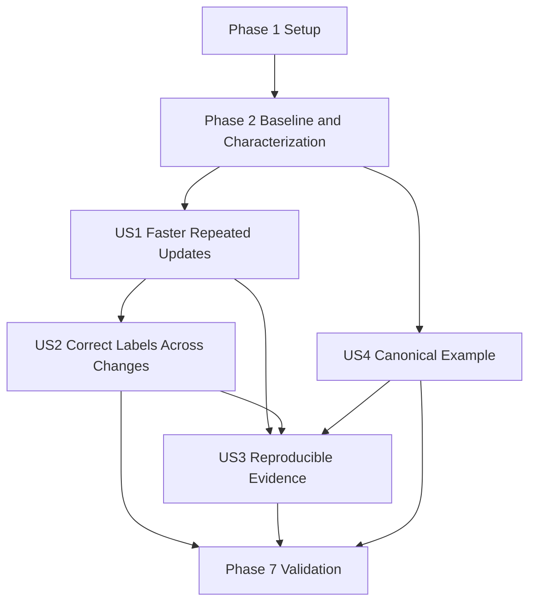

# Tasks: Improve Bar Label Performance

**Input**: Design documents from `/specs/001-improve-bar-label-performance/`

**Prerequisites**: plan.md, spec.md, research.md, data-model.md, contracts/, quickstart.md

**Tests**: The feature specification explicitly requires unit, Cypress component, visual/behavioral,
accessibility, build, lint, and browser-level performance validation. Test tasks MUST be completed
before their corresponding implementation tasks and observed to fail for the intended reason.

**Organization**: Tasks are grouped by user story. Foundational tasks create the canonical
production scenario and capture baseline evidence before rendering implementation begins.

**Test scope update (2026-10-12)**: The user subsequently requested that the focused Cypress cache
test be reintroduced and the complete planned implementation resume.

## Format: `[ID] [P?] [Story] Description`

- **[P]**: Can run in parallel because it uses different files and has no incomplete dependency.
- **[Story]**: Maps the task to a user story in spec.md.
- Every task includes an exact repository-relative file path.

## Phase 1: Setup (Shared Infrastructure)

**Purpose**: Establish evidence storage and verify the required component-test command before
feature implementation.

- [x] T001 Create the baseline/post-change environment, raw-run, median, long-task, limitations, and
      unverified-risk tables in specs/001-improve-bar-label-performance/performance-results.md using
      the PerformanceScenario and PerformanceEvidenceSet fields from
      specs/001-improve-bar-label-performance/data-model.md
- [x] T002 Run `npm run cypress:component:viz`, record the pre-feature result in
      specs/001-improve-bar-label-performance/performance-results.md, and if the existing
      `demo-app:build:devleopment` reference is the blocker, correct only that reference to
      `demo-app:build:development` in libs/viz/project.json and rerun the command

---

## Phase 2: Foundational (Blocking Prerequisites)

**Purpose**: Build the reproducible canonical scenario, record browser baseline evidence, and settle
the stacked-label compatibility boundary before any optimization code is changed.

**CRITICAL**: T006 MUST be complete before any User Story 1 or User Story 2 implementation task
begins.

- [x] T003 [P] Add a deterministic approximately 50-bar labeled dataset, unchanged-text update,
      changed-text update, resize/scale-only update, and named User Timing boundaries in
      apps/demo-app/src/app/content/viz/bars-content/bars-example/bars-example.component.ts
- [x] T004 [P] Add controls that invoke the three deterministic update scenarios without changing
      consumer-facing library configuration in
      apps/demo-app/src/app/content/viz/bars-content/bars-example/bars-example.component.html
- [x] T005 Build and serve the production configuration, verify all four scenarios at
      `http://localhost:4200/viz/bars`, and record the exact dataset, viewport, browser, hardware,
      OS, throttling, warm-up, and run procedure in
      specs/001-improve-bar-label-performance/performance-results.md
- [x] T006 Capture at least 20 baseline browser traces for initial render, unchanged-text warm
      update, changed-text update, and resize/scale-only update; record raw label-rendering time,
      synchronous `Layout` time, attributable tasks of at least 50 ms, medians, trace references,
      and the forced-layout hypothesis status in
      specs/001-improve-bar-label-performance/performance-results.md
- [x] T007 [P] Characterize whether configured stacked labels currently reach the shared
      `BarsComponent.drawLabels()` contract in
      libs/viz/src/lib/stacked-bars/stacked-bars.component.spec.ts and record the supported or
      pre-existing unsupported boundary in
      specs/001-improve-bar-label-performance/performance-results.md

**Checkpoint**: Reproducible baseline evidence exists, forced layout remains a hypothesis unless
traces support it, and stacked-label scope is explicit.

---

## Phase 3: User Story 1 - Faster Repeated Chart Updates (Priority: P1) MVP

**Goal**: Reuse valid dimensions for warm unchanged-text updates and reduce measured label rendering
and synchronous layout time without consumer configuration changes.

**Independent Test**: Render approximately 50 visible labels, perform at least 20 unchanged-text
warm updates, prove eligible labels are not remeasured, and achieve at least a 50% reduction in both
median main-thread label-rendering and synchronous-layout time with no new attributable task of 50
ms or more.

### Tests for User Story 1

- [x] T008 [P] [US1] Add failing unit tests for cold measurement, unchanged-text reuse, one-string
      selective invalidation, and weak element ownership in
      libs/viz/src/lib/bars/bars.component.spec.ts; require `renderedText` as string,
      `fontGeneration` as a nonnegative integer, and `width`/`height` as nonnegative numbers per
      specs/001-improve-bar-label-performance/data-model.md
- [x] T009 [P] [US1] Add a focused Cypress component test proving cold measurement, unchanged-text
      reuse, one-string selective invalidation, and current-geometry placement in
      libs/viz/src/lib/bars/config/labels/bars-labels.cy.ts

### Implementation for User Story 1

- [x] T010 [US1] Add the private `RenderedLabelMeasurement`, `TypographyFingerprint`, and
      per-element `WeakMap<SVGTextElement, RenderedLabelMeasurement>` state in
      libs/viz/src/lib/bars/bars.component.ts with validity fields for rendered text, computed
      typography, formatter identities, font generation, width, and height
- [x] T011 [US1] Refactor `drawLabels()` into join/current-text writes,
      cache-hit-or-batched-geometry reads, and placement writes in
      libs/viz/src/lib/bars/bars.component.ts; write current text synchronously before measurement,
      correct `visiblity` to `visibility`, and retain existing placement transitions
- [x] T012 [US1] Run the focused unit and Cypress tests for T008-T011 and record measurement call
      counts and rendering outcomes in
      specs/001-improve-bar-label-performance/performance-results.md
- [x] T013 [US1] Repeat at least 20 unchanged-text warm-update traces with the baseline environment
      and method, then record whether the 50% median label-rendering/layout reduction and
      no-new-50-ms-long-task criteria pass in
      specs/001-improve-bar-label-performance/performance-results.md

**Checkpoint**: The MVP independently demonstrates transparent measurement reuse and the required
warm- update improvement.

---

## Phase 4: User Story 2 - Correct Labels Across Changes (Priority: P1)

**Goal**: Preserve all label behavior while invalidating only incompatible measurements across text,
typography, font, geometry, membership, transition, and variant changes.

**Independent Test**: Exercise cold and updated standard, grouped, and applicable stacked bars
across all specified invalidation and geometry-only scenarios; verify current text, placement,
styling, visibility, transitions, accessibility, value categories, bounded lifetime, and public
compatibility.

### Tests for User Story 2

- [x] T014 [P] [US2] **Waived**: add no further feature-specific unit tests per the 2026-10-12
      test-scope update
- [x] T015 [P] [US2] **Waived**: add no further feature-specific Cypress tests per the 2026-10-12
      test-scope update
- [x] T016 [P] [US2] **Waived**: add no further grouped-bar feature tests per the 2026-10-12
      test-scope update
- [x] T017 [P] [US2] **Waived**: T007 already proves stacked labels are pre-existing unsupported
      behavior; add no further stacked feature tests

### Implementation for User Story 2

- [x] T018 [US2] Implement normalized computed-style fingerprinting for font family, size, weight,
      style, stretch, variant, line height, letter spacing, word spacing, text transform, text
      rendering, and writing mode plus formatter identity checks in
      libs/viz/src/lib/bars/bars.component.ts
- [x] T019 [US2] Implement feature-detected `document.fonts.ready` and `loadingdone` invalidation,
      font-generation increments, cache replacement, nonanimated redraw, single listener
      registration, and inherited DestroyRef cleanup in libs/viz/src/lib/bars/bars.component.ts
- [x] T020 [US2] Complete hidden-label bypass, current-geometry placement on
      resize/scale/value/orientation changes, entered-label cold measurement, exited-element weak
      lifetime, reorder safety, and stale-transition interruption in
      libs/viz/src/lib/bars/bars.component.ts
- [x] T021 [US2] Preserve the T007/T017 pre-existing unsupported stacked-label boundary and make no
      stacked implementation change
- [x] T022 [US2] Run focused standard, grouped, and applicable stacked unit/Cypress suites and
      record positive, negative, zero, null, undefined, nonnumeric, inside/outside, color,
      visibility, transition, accessibility, resize, membership, and ordering results in
      specs/001-improve-bar-label-performance/performance-results.md

**Checkpoint**: Existing rendering and public behavior remain compatible across all required
invalidation, geometry, lifecycle, and supported variant scenarios.

---

## Phase 5: User Story 3 - Reproducible Performance Evidence (Priority: P2)

**Goal**: Provide repeatable baseline and completed browser evidence that separates measured results
from hypotheses, limitations, and unverified browser-specific risks.

**Independent Test**: A reviewer follows the documented procedure and reproduces directly comparable
initial, warm unchanged-text, changed-text, and resize/scale-only results under the same environment
and method.

### Validation for User Story 3

- [x] T023 [US3] Capture at least 20 post-change browser traces for all four scenarios using the
      unchanged baseline browser, hardware, data, viewport, production build, throttling, User
      Timing boundaries, and trace method in
      specs/001-improve-bar-label-performance/performance-results.md
- [x] T024 [US3] Calculate and compare baseline/post-change medians, measurement reuse, selective
      invalidation, synchronous-layout time, and attributable tasks of at least 50 ms in
      specs/001-improve-bar-label-performance/performance-results.md without generalizing results
      beyond the recorded setup
- [x] T025 [US3] Document reproduction steps, raw-run/trace references, measurement limitations,
      forced-layout conclusion status, and remaining unverified browser-specific risks in
      specs/001-improve-bar-label-performance/performance-results.md and reconcile any procedure
      corrections in specs/001-improve-bar-label-performance/quickstart.md

**Checkpoint**: Another reviewer can reproduce the evidence and distinguish observations from
claims.

---

## Phase 6: User Story 4 - Representative Canonical Example (Priority: P3)

**Goal**: Make the canonical Bars page a usable approximately 50-label correctness and performance
example without presenting benchmark results as guarantees.

**Independent Test**: Open `/viz/bars`, confirm approximately 50 visible labels and accessible
update controls, trigger each scenario, inspect correctness, and verify documentation scopes all
performance language to the local measurement setup.

### Implementation for User Story 4

- [x] T026 [P] [US4] Document the representative labeled chart, its update controls, manual
      correctness workflow, and locally scoped performance-measurement guidance in
      apps/demo-app/src/assets/viz/content/bars.md without publishing benchmark results as general
      guarantees
- [x] T027 [P] [US4] Add responsive layout and stable control/chart dimensions for the approximately
      50-bar scenario in
      apps/demo-app/src/app/content/viz/bars-content/bars-example/bars-example.component.scss
- [x] T028 [US4] Add accessible names, instructions, and state communication for all
      performance-scenario controls while preserving the canonical chart workflow in
      apps/demo-app/src/app/content/viz/bars-content/bars-example/bars-example.component.html

**Checkpoint**: The canonical example supports manual correctness and performance review and remains
clear about the limits of its measurements.

---

## Phase 7: Polish & Cross-Cutting Validation

**Purpose**: Verify affected-project gates, public compatibility, scope, and end-to-end
instructions.

- [x] T029 Run `npm run lint:viz`, `npm run build:viz`,
      `npx nx test viz --watch=false --browsers=ChromeHeadlessNoSandbox`,
      `npm run cypress:component:viz`, `npm run lint:demo-app`, and `npm run build:demo-app`; record
      commands, outcomes, and any unavailable-check risk in
      specs/001-improve-bar-label-performance/performance-results.md
- [x] T030 Audit libs/viz/src/public-api.ts and libs/viz/src/lib/bars/index.ts against
      specs/001-improve-bar-label-performance/contracts/public-api-and-rendering-contract.md and
      record confirmation that no export, selector, input, output, builder, configuration, or
      required consumer action changed in
      specs/001-improve-bar-label-performance/performance-results.md
- [x] T031 Verify `apps/my-work` and unrelated marks, axes, and tooltip files remain unchanged, then
      document scope compliance, compatibility risks, assumptions, and unverified claims in
      specs/001-improve-bar-label-performance/performance-results.md
- [x] T032 Execute every scenario and command in
      specs/001-improve-bar-label-performance/quickstart.md, correct any stale instructions in that
      file, and record final acceptance against SC-001 through SC-008 in
      specs/001-improve-bar-label-performance/performance-results.md

---

## Dependencies & Execution Order

### Phase Dependencies

- **Setup (Phase 1)**: No dependencies.
- **Foundational (Phase 2)**: Depends on T001-T002 and blocks rendering implementation.
- **User Story 1 (Phase 3)**: Tests may start after Phase 2; T010-T013 require baseline T006.
- **User Story 2 (Phase 4)**: Tests may start after Phase 2; implementation integrates with the US1
  cache and phased render path, so T018-T022 depend on T010-T011.
- **User Story 3 (Phase 5)**: Depends on completed US1 and US2 behavior and the unchanged baseline
  procedure.
- **User Story 4 (Phase 6)**: Documentation and accessibility polish can start after T003-T004 and
  proceed in parallel with US1/US2; final acceptance depends on their completed behavior.
- **Polish (Phase 7)**: Depends on every desired user story.

### User Story Dependency Graph



### Within Each User Story

- Write and run story tests before implementation and confirm intended failures.
- Add internal measurement records before phased rendering logic.
- Complete core behavior before browser evidence or documentation claims.
- Preserve the exact baseline environment and method for all post-change comparisons.

### Parallel Opportunities

- T003 and T004 can run in parallel; T007 can run alongside the demo baseline setup.
- T008 and T009 can run in parallel before US1 implementation.
- T014-T017 can run in parallel across standard, grouped, and stacked test files.
- T026 and T027 can run in parallel; T028 follows the established control markup.

---

## Parallel Examples

### User Story 1

```text
Task T008: Add cache and selective invalidation unit tests in libs/viz/src/lib/bars/bars.component.spec.ts
Task T009: Add rendered measurement-reuse tests in libs/viz/src/lib/bars/config/labels/bars-labels.cy.ts
```

### User Story 2

```text
Task T014: Add formatter, typography, and font lifecycle unit tests in libs/viz/src/lib/bars/bars.component.spec.ts
Task T015: Add transition, geometry, membership, hidden, and accessibility Cypress tests in libs/viz/src/lib/bars/config/labels/bars-labels.cy.ts
Task T016: Add grouped parity tests in libs/viz/src/lib/grouped-bars/grouped-bars.component.spec.ts
Task T017: Add applicable stacked parity characterization in libs/viz/src/lib/stacked-bars/stacked-bars.component.spec.ts
```

### User Story 3

US3 evidence tasks are intentionally sequential: collect identical post-change traces, calculate the
comparison, then document reproducibility and limitations.

### User Story 4

```text
Task T026: Update canonical guidance in apps/demo-app/src/assets/viz/content/bars.md
Task T027: Add responsive example styling in apps/demo-app/src/app/content/viz/bars-content/bars-example/bars-example.component.scss
```

---

## Implementation Strategy

### MVP First (User Story 1)

1. Complete T001-T007 so the evidence method and compatibility boundaries are fixed.
2. Write failing US1 tests in T008-T009.
3. Implement the weak measurement cache and phased rendering in T010-T011.
4. Validate focused behavior in T012.
5. Stop and assess the measured MVP gate in T013 before expanding invalidation behavior.

### Incremental Delivery

1. Setup + baseline + characterization establishes trustworthy evidence.
2. US1 delivers measurable unchanged-text warm-update reuse.
3. US2 closes all correctness, invalidation, lifecycle, accessibility, and supported-variant cases.
4. US4 can proceed alongside implementation after the canonical controls exist.
5. US3 records final comparable evidence after behavior stabilizes.
6. Cross-cutting validation proves both affected Nx projects and public compatibility.

### Parallel Team Strategy

1. One developer prepares the canonical baseline while another characterizes stacked labels.
2. After baseline capture, unit and Cypress tests for each story can be authored in parallel.
3. One owner performs `bars.component.ts` implementation sequentially to avoid conflicting edits.
4. Demo documentation and styling proceed independently after scenario controls stabilize.

---

## Notes

- `[P]` tasks operate on different files or independent evidence and can run concurrently.
- Story labels provide requirement traceability; setup, foundation, and polish tasks intentionally
  omit them.
- Baseline T006 is a hard gate before T010 or any other rendering optimization.
- T021 is conditional on recorded characterization and MUST NOT create a new stacked-label policy.
- Commit with the repository's conventional semantic commit format after each task or logical group.
- Keep all changes within `viz`, canonical `demo-app` surfaces, and feature evidence artifacts.
